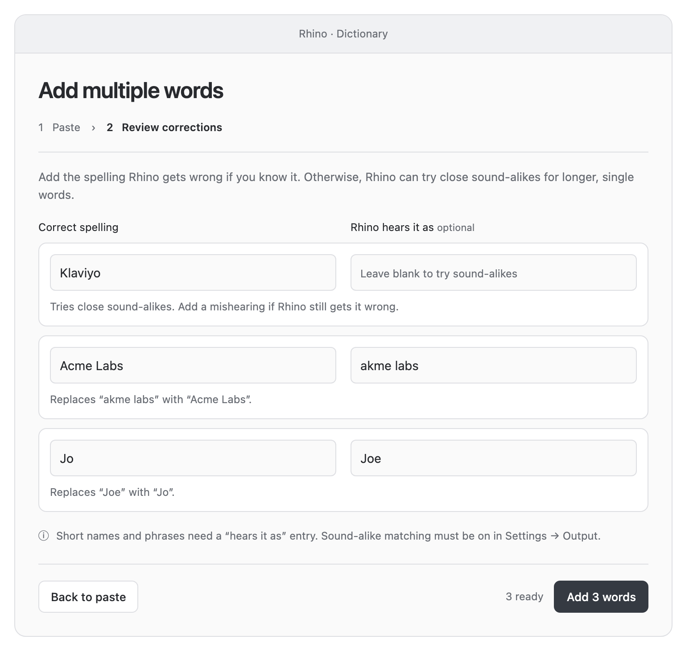

# Bulk dictionary — design proposal

Status: interactive mockup for review; the Rhino app has not been changed.

Download [index.html](index.html) using GitHub's download button and open it
in a browser, or open it from a local checkout. It works offline and does not
read or change your Rhino dictionary. Click **Back to paste** to try the full
flow. The editable conversation fragment is [source.html](source.html).

## Proposed flow

1. Paste one word per line, or copy two spreadsheet columns: **Correct
   spelling**, then **Rhino hears it as** (optional). No header row is needed.
2. Review the entries and fill in any known mishearings.
3. Add the entries together.

A word by itself tells Rhino the desired spelling. Existing sound-alike
matching tries close misses for eligible single words with at least five
letters; it does not train the speech model or guarantee a correction. It
avoids changing recognized English words and requires sound-alike matching
to be enabled in Settings → Output.

An explicit pair such as `Joe → Jo` tells Rhino exactly what to replace.
Short words and phrases need this second value. The proposed review screen
asks for it before saving those entries. This requirement is a design choice
for review, not a change to the existing app.

## Scope and remaining work

The prototype demonstrates newline/tab-separated paste, blank-line handling,
identical-row deduplication, editable corrections, validation, and a simulated
save. CSV files, headers, existing-dictionary conflicts, alternate mishearings,
and real persistence are outside this mockup. Production work still needs to
integrate with the shared Dictionary/Settings editor and preserve existing
rules when merging imported entries.

The standalone export retains the mockup's own styles and logic, omits the
visualization renderer's unused remote libraries and host bridge, and blocks
network requests through its content security policy.

## Validation

Checked in Chrome: initial review state, one- and two-column paste, required
mishearing for a short name, empty-input rejection, and simulated save. The
360px layout has no horizontal overflow. Desktop screenshot reviewed; no
JavaScript runtime errors or HTTP requests observed. App builds and native
tests are not applicable to this design-only change.
